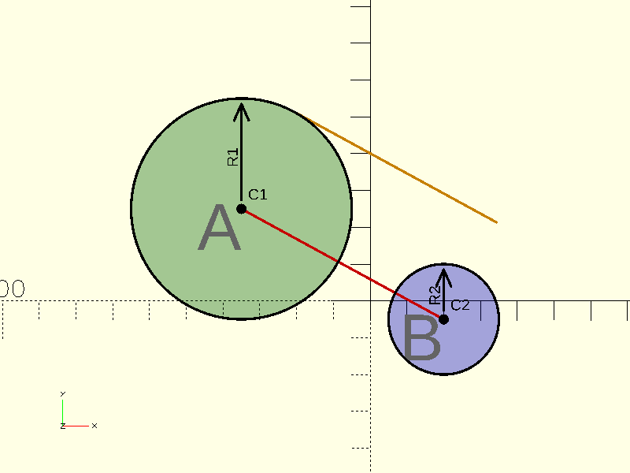
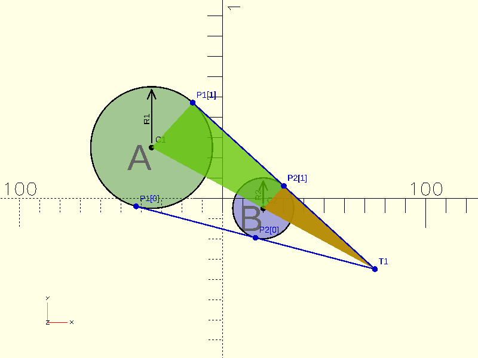
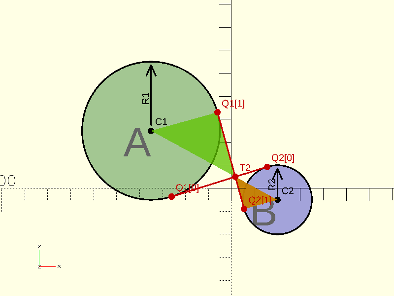
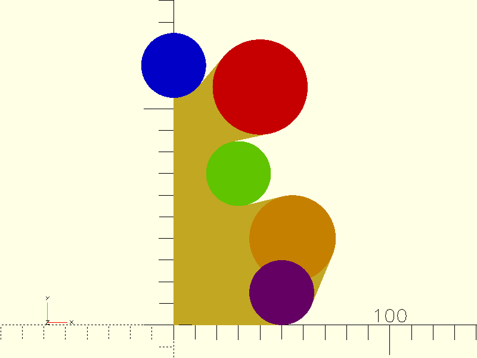
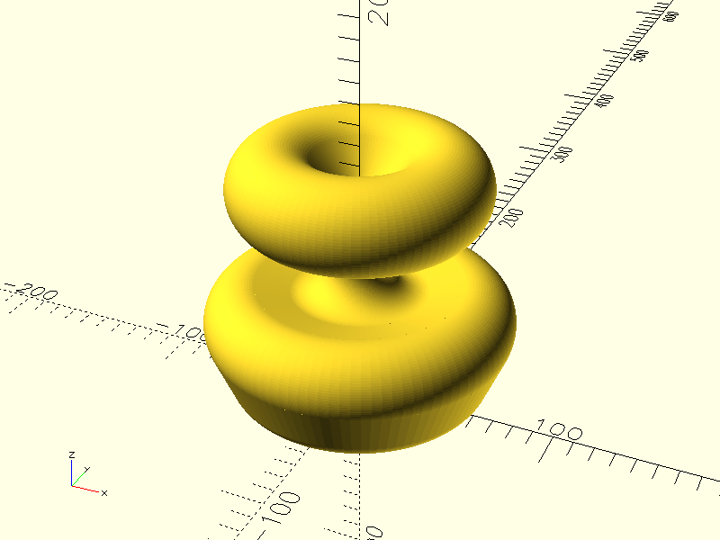
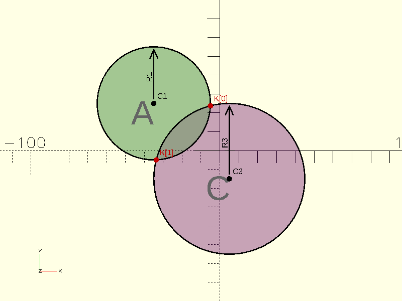
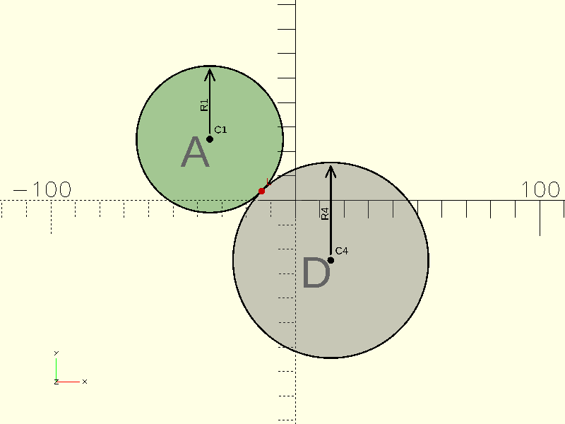
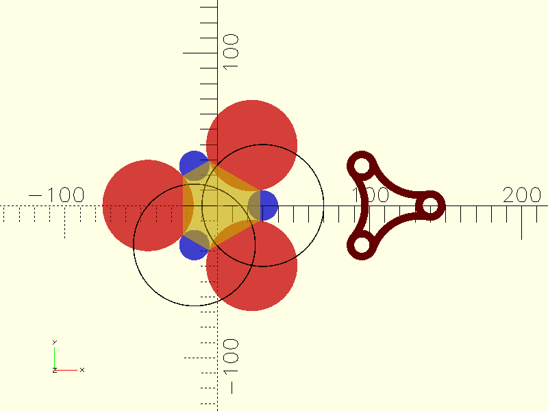

# tangent-lines

OpenSCAD functions for the tangent lines, intersection points and touch
points of circles, with a tutorial on the math behind them.

The library and the tutorial are by
[Stone Age Sculptor](https://www.printables.com/@Stone_Age_Sculptor), from
[Tutorial: Tangent lines of circles in OpenSCAD](https://www.printables.com/model/1030379-tutorial-tangent-lines-of-circles-in-openscad)
on Printables, with improvements by Reddit users ImpatientProf and oldesole1.
Changes here are listed under [Changes from the original](#changes-from-the-original).
Everything is CC0 (public domain).

## Usage

```openscad
include <tangent_lines.scad>

C1 = [-35, 25]; R1 = 30;
C2 = [20, -5];  R2 = 15;

T1 = PointForExternal(C1, R1, C2, R2);  // where the external tangents cross
P1 = TangentPoints(C1, R1, T1);         // their two points on the first circle
P2 = TangentPoints(C2, R2, T1);         // and on the second
```

| Function                                          | Returns |
| ------------------------------------------------- | ------- |
| `PointForExternal(Centre1, Radius1, Centre2, Radius2)` | The point where the two external tangent lines cross. Not defined when the radii are equal. |
| `PointForInternal(Centre1, Radius1, Centre2, Radius2)` | The point where the two internal tangent lines cross, between the circles. |
| `TangentPoints(Centre, Radius, Point)`            | The two points on the circle whose tangent lines pass through `Point`. |
| `IntersectionPoints(Center1, Radius1, Center2, Radius2)` | The two points where overlapping circles cross. |
| `TouchPoint(Center1, Radius1, Center2, Radius2)`  | The point where two circles touch, from outside or with one inside the other. |

`DrawLine(Point1, Point2, line_width = 0.5)` is a module that draws a line
with square ends.

`TangentPoints()` returns its points in a consistent order: given the same
common point, index 0 on one circle and index 0 on the other lie on the same
tangent line, and so do the two index 1 points.

## Tutorial

By Stone Age Sculptor. Every picture is made with
`tangent_lines_tutorial.scad`: set `tutorial_section` to choose one.

### Rule number one: don't use tangent lines in OpenSCAD

If possible, try to avoid tangent lines. If you only want round corners, then
there are easier ways. OpenSCAD can make round corners (both inside corners and
outside corners) in 2D with the `offset()` function. There are also public
domain splines for round shapes, such as the public domain OpenSCAD Bezier
function by William A. Adams. Those are easier to use in my opinion.

Only when a mechanical part requires a shape with circles and tangent lines
should they be used.

### Classic calculation

The classic way to calculate the tangent points on a circle is with a parallel
line. The line is parallel to a line between the centers of two circles. The
line is inside the larger circle for external tangent points (section 0):


The line is outside the smaller circle for internal tangent points (section 1):



There are similar angles and distances and they can be used to calculate the
tangent points.

### With the common tangent point and triangles

To understand the tangent points, I thought it was easier to calculate the
common points first. Both the external tangent points and the internal tangent
points for two circles share a common point.

To calculate the common point, Reddit user ImpatientProf showed a smart way by
looking at similar triangles
([r/openscad: I spent a few days in tangent lines](https://www.reddit.com/r/openscad/comments/1fqa33m/i_spent_a_few_days_in_tangent_lines/)).

Suppose there are two circles called "A" and "B". The center of "A" is "C1" and
the radius of "A" is R1. In OpenSCAD, both circles can be drawn like this:

```openscad
C1 = [-35, 25];
R1 = 30;
translate(C1)
  circle(R1);

C2 = [20, -5];
R2 = 15;
translate(C2)
  circle(R2);
```

When the common point is used (called "T1" in the picture below), then there
are similar triangles. The size of the triangles is relative to the radius of
the circle. Because OpenSCAD can do calculations with vectors, the calculation
of "T1" is very simple in OpenSCAD:

```openscad
// The triangles are similar:
// (C1-T1)/R1 = (C2-T1)/R2
// T1 can be calculated from that:
T1 = (R2 * C1 - R1 * C2) / (R2 - R1);
```

When "T1" is known, the angles for the tangent points still have to be
calculated, in a similar way to the classic calculation (section 2):



The disadvantage of calculating T1 first is when both circles have the same
radius. Then T1 can not be calculated.

For the internal tangent lines, the common tangent point is between the
circles. There are also similar triangles there (section 3):



The calculation of T2 is only slightly different:

```openscad
T2 = (R2 * C1 + R1 * C2) / (R2 + R1);
```

### Example tangent lines

This is an example with internal tangent lines and external tangent lines.
When the coordinates of all the tangent points are known, a polygon can be used
to fill a shape (section 4):



Since the polygon draws straight lines between the points, the circles of the
inner corners have to be removed and the circles for the outer corners have to
be added. The shape in 2D can be rotated into a 3D shape (section 5):



### Intersection points

An extra function calculates the intersection points (section 6):



### Touch point

A small function calculates the touch point (section 7):



### Example: intersection and touch points of circles

The picture below shows the use of intersection points and touch points
between circles (section 9).

Suppose that the position and size of the blue circles is known. Then the shape
on the right can be calculated, depending on the size of the red circles.



First the center points of the red circles are calculated. The black circle
edge has a radius of the blue and red circle added together. They cross each
other in the center of the lower-right red circle. Then all the positions and
sizes of the blue and red circles are known.

After calculating all six touch points, a polygon can be drawn between those
points. The yellow part is the polygon. By adding the blue circles and removing
the red circles, the final shape can be calculated.

## Development

With [just](https://just.systems/) and OpenSCAD installed:

- `just test` runs the checks in `tests/test_tangent_lines.scad` and renders
  every tutorial section with OpenSCAD warnings as errors. The checks test
  geometry: a tangent point lies on its circle with the radius perpendicular to
  the tangent line, intersection and touch points lie on both circles.
- `just images` regenerates the pictures in `assets/`.

## Changes from the original

- The library is `tangent_lines.scad` and the tutorial includes it by that name.
- `TouchPoint()` handles a circle touching the inside of another (version 3.1).
  It returned the center of the smaller circle in that case.
- Tests, a justfile, and pictures regenerated from the script.

## License

CC0 1.0 Universal. See [LICENSE](./LICENSE).
